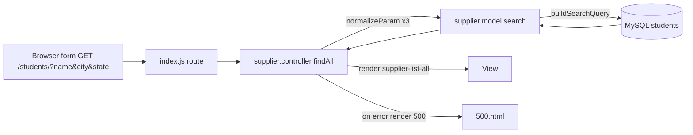

# Design Document

## Overview

This feature adds server-side search and filtering to `GET /students/`. A small GET form on the existing list page sends `name`, `city`, and `state` query parameters. The controller normalizes them, the model builds a parameterized `SELECT` with `AND`-combined conditions, and the same view renders the results.

Design decisions:

- **Pure helpers in the model.** `normalizeParam` and `buildSearchQuery` have no I/O, so they are easy to test and keep all SQL construction in one place.
- **New `Supplier.search` function; `getAll` untouched.** `search` with no criteria issues exactly `SELECT * FROM students`, which preserves the pre-feature result and order (Req 3.3). No `ORDER BY` is added, so ordering matches the unfiltered list.
- **Case-insensitive matching is explicit.** Use `LOWER(col) = LOWER(?)` and `LOWER(name) LIKE LOWER(?) ESCAPE '\\'` rather than relying on the column collation.
- **No new dependencies at runtime.** The view uses mustache sections already used by the app. Mustache's `{{value}}` escapes HTML, which satisfies Req 4.4 and 6.2.
- **Existing quirks left alone.** The per-request connection, the `dbConnect` throw on connect failure, and the unrelated known issues (`supplier.i`, `findById` interpolation) are out of scope.

## Architecture



The route in `index.js` is unchanged (`app.get("/students/", supplier.findAll)`).

## Components and Interfaces

### Model: `app/models/supplier.model.js`

```js
const NAME_MAX = 100;
const CITY_STATE_MAX = 50;

// Returns a trimmed string truncated to max characters.
// Non-string values (undefined, array, object) return "".
Supplier.normalizeParam = (value, max) => {
    if (typeof value !== "string") return "";
    return value.trim().slice(0, max);
};

// Escapes \ % _ so they match literally in LIKE.
Supplier.escapeLike = (s) => s.replace(/[\\%_]/g, "\\$&");

// criteria: {name, city, state}, already normalized strings.
// Returns {sql, params}. Only fixed SQL fragments are used; values go in params.
Supplier.buildSearchQuery = (criteria) => {
    const where = [];
    const params = [];
    if (criteria.name) {
        where.push("LOWER(name) LIKE LOWER(?) ESCAPE '\\\\'");
        params.push("%" + Supplier.escapeLike(criteria.name) + "%");
    }
    if (criteria.city) {
        where.push("LOWER(city) = LOWER(?)");
        params.push(criteria.city);
    }
    if (criteria.state) {
        where.push("LOWER(state) = LOWER(?)");
        params.push(criteria.state);
    }
    const sql = "SELECT * FROM students" + (where.length ? " WHERE " + where.join(" AND ") : "");
    return {sql, params};
};

// Callback style: result(err, data). err is null on success, data is null on failure.
Supplier.search = (criteria, result) => { /* dbConnect, query(sql, params, cb) */ };
```

`Supplier.search` follows the existing model pattern: open a connection with `Supplier.dbConnect()`, run `dbConn.query(sql, params, cb)`, log errors to the console, and call `result(err, null)` or `result(null, rows)`.

The SQL string literal `ESCAPE '\\\\'` in JS source yields `ESCAPE '\\'` in SQL, which MySQL reads as a single backslash escape character. This will be checked against a real MySQL instance during testing.

### Controller: `app/controller/supplier.controller.js`

`findAll` is changed to:

```js
exports.findAll = (req, res) => {
    const criteria = {
        name: Supplier.normalizeParam(req.query.name, 100),
        city: Supplier.normalizeParam(req.query.city, 50),
        state: Supplier.normalizeParam(req.query.state, 50)
    };
    const hasCriteria = !!(criteria.name || criteria.city || criteria.state);
    Supplier.search(criteria, (err, data) => {
        if (err)
            res.render("500", {message: "There was a problem retrieving the list of students"});
        else res.render("supplier-list-all", {
            students: data,
            search: criteria,
            hasCriteria: hasCriteria,
            noResults: hasCriteria && data.length === 0
        });
    });
};
```

The 500 message is generic, so no SQL or DB error detail reaches the user (Req 6.4). The error object is only logged by the model.

### View: `views/supplier-list-all.html`

Changes:

- Add a `<form method="get" action="/students/">` above the table with three text inputs `name`, `city`, `state`, values bound to `{{search.name}}`, `{{search.city}}`, `{{search.state}}`, and a submit button. Add `maxlength` of 100/50/50 as a convenience; the server enforces limits regardless.
- Add `{{#hasCriteria}}<a href="/students/">Clear search</a>{{/hasCriteria}}`.
- Inside `<tbody>`, after the `{{#students}}` section, add `{{#noResults}}<tr><td colspan="7">No students match your search.</td></tr>{{/noResults}}`.
- Table columns and the edit link stay as they are.

Echoed values are the normalized (trimmed, truncated) values, HTML-escaped by mustache `{{ }}`. The triple-brace and `&` forms are not used.

## Data Models

No schema change. Criteria object passed to the model:

| Field | Type | Max length | Meaning |
|-------|------|-----------|---------|
| name  | string | 100 | Case-insensitive substring match on `students.name` |
| city  | string | 50 | Case-insensitive equality on `students.city` |
| state | string | 50 | Case-insensitive equality on `students.state` |

An empty string means "not active". View model additions: `search` (the criteria), `hasCriteria` (boolean), `noResults` (boolean).

## Correctness Properties

*A property is a characteristic or behavior that should hold true across all valid executions of a system-essentially, a formal statement about what the system should do. Properties serve as the bridge between human-readable specifications and machine-verifiable correctness guarantees.*

Prework reflection: the parameterization, empty-ignored, and combine criteria (1.2, 2.4, 6.1, 1.4, 2.5, 3.1, 3.2, 3.5) collapse into two builder properties. The truncation and non-string criteria (1.5, 2.6, 6.3) collapse into one normalization property. The message criteria (1.6, 2.7, 3.4, 5.1-5.3) collapse into one view-model property. SQL matching semantics (1.1, 2.1-2.3) depend on MySQL and are covered by integration examples.

### Property 1: Normalization yields a bounded, trimmed string

*For any* value (string of any content or length, undefined, array, or object) and any max length, `normalizeParam` returns a string with no leading or trailing whitespace whose length is at most max, and returns `""` when the value is not a string or is whitespace only. For strings it equals the trimmed input truncated to max.

**Validates: Requirements 1.4, 1.5, 2.5, 2.6, 3.5, 6.3**

### Property 2: LIKE escaping round trip

*For any* string, after `escapeLike`, every `%`, `_`, and `\` is preceded by an escaping backslash, and removing the escape backslashes restores the original string.

**Validates: Requirements 1.3**

### Property 3: Query text is independent of user values

*For any* two criteria objects with the same set of active (non-empty) fields, `buildSearchQuery` returns identical `sql` text, the number of `?` placeholders equals `params.length`, and no active value appears as a substring of the SQL unless it is itself part of the fixed SQL fragments' characters. In particular, SQL injection strings only ever appear in `params`.

**Validates: Requirements 1.2, 2.4, 6.1**

### Property 4: Params reflect exactly the active criteria

*For any* criteria object, `params` contains, in order name, city, state, one entry per active field (name wrapped as `%` + escaped value + `%`, city and state unchanged), and the `WHERE` clause joins the same number of conditions with `AND`. When no field is active, the result is exactly `{sql: "SELECT * FROM students", params: []}`.

**Validates: Requirements 1.4, 2.5, 3.1, 3.2, 3.3, 3.5**

### Property 5: Empty-result message flag

*For any* query parameters and any model result list, the controller renders `supplier-list-all` with `noResults` true if and only if at least one criterion is active and the list is empty, and with `hasCriteria` true if and only if at least one criterion is active. On a model error the controller renders `500` and not `supplier-list-all`.

**Validates: Requirements 1.6, 2.7, 3.4, 4.6, 5.1, 5.2, 5.3, 5.4, 6.4**

## Error Handling

- **Database error in search:** the model logs the error and calls `result(err, null)`. The controller renders `500.html` with a generic message. Stored data is unchanged because the feature only runs `SELECT`.
- **Array or object parameters** (for example `?name=a&name=b` or `?name[x]=y`): `normalizeParam` returns `""` and the criterion is ignored. No error is raised.
- **Oversized input:** truncated to 100/50/50 characters. No error is raised.
- **Connection failure:** `Supplier.dbConnect` already throws on connect error. That behavior is existing and not changed by this feature.
- **HTML in echoed values:** escaped by mustache.

## Testing Strategy

The repo has no test framework. Add `jest` and `fast-check` as pinned devDependencies and a `"test": "jest"` script. Tests live in `code/resources/codebase_partner/test/`.

**Why PBT applies:** `normalizeParam`, `escapeLike`, `buildSearchQuery`, and the controller's view-model logic (with a mocked model) are pure or near-pure with a large input space. PBT does not apply to MySQL matching semantics or template layout, which use example and integration tests.

**Property-based tests** (fast-check, minimum 100 runs each, one test per property, each tagged with a comment):

- `Feature: student-search-filter, Property 1: Normalization yields a bounded, trimmed string`
- `Feature: student-search-filter, Property 2: LIKE escaping round trip`
- `Feature: student-search-filter, Property 3: Query text is independent of user values`
- `Feature: student-search-filter, Property 4: Params reflect exactly the active criteria`
- `Feature: student-search-filter, Property 5: Empty-result message flag` (mock `Supplier.search` and `res.render`)

**Unit and example tests:**

- Render `supplier-list-all` with mustache: three inputs, `method="get"`, `action="/students/"`, existing column headers and edit link, one row per record, zero rows with headers only (Req 4.1-4.3, 7.4, 7.5).
- Render with `<script>"'&` in `search` values and assert they appear escaped (Req 4.4, 6.2).
- Clear link appears only when `hasCriteria` (Req 4.5).
- Mocked model error renders `500` with a message that contains no SQL (Req 4.6, 6.4).
- No-criteria SQL equals `SELECT * FROM students` (Req 3.3).

**Integration tests (a few examples against a local test MySQL):**

- Name substring, case-insensitive (Req 1.1).
- Literal `%` and `_` in names, confirming the `ESCAPE` clause works (Req 1.3).
- City only, state only, city and state combined, case-insensitive (Req 2.1-2.3).
- Combined name, city, and state returns the intersection (Req 3.1).

Requirements 7.2 and 7.3 cover existing behavior that this feature does not touch, so no new tests are added for them.
